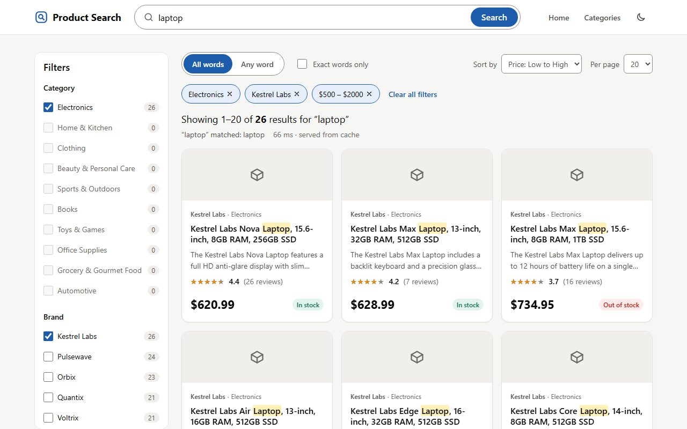
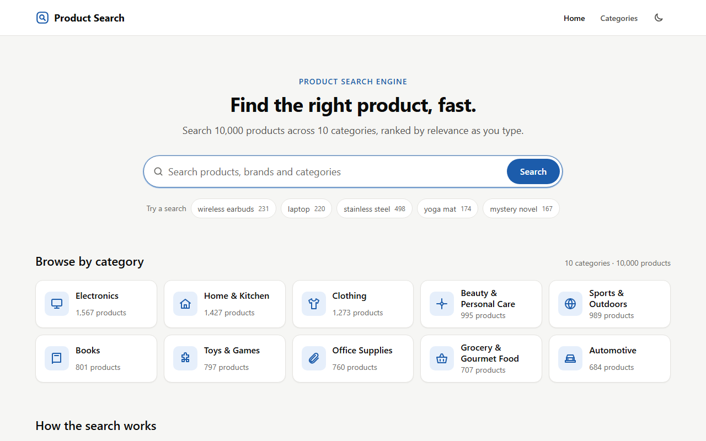
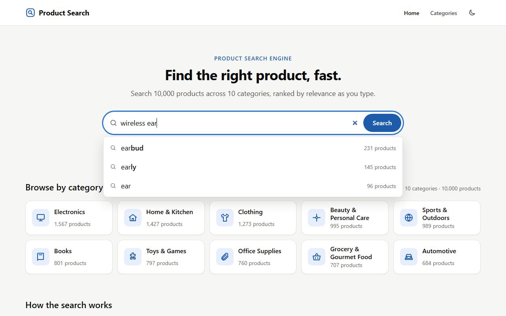
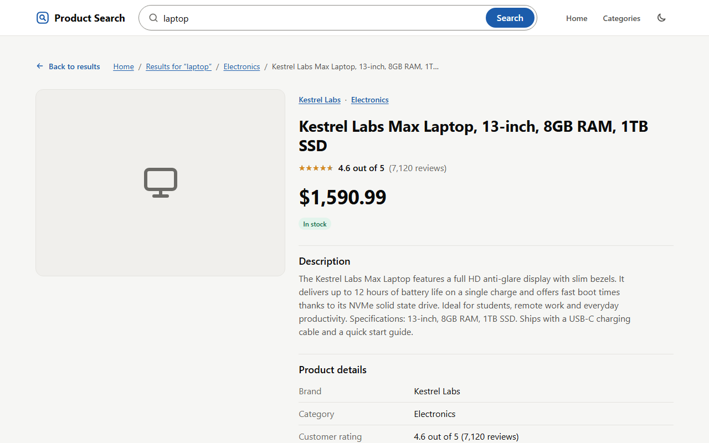
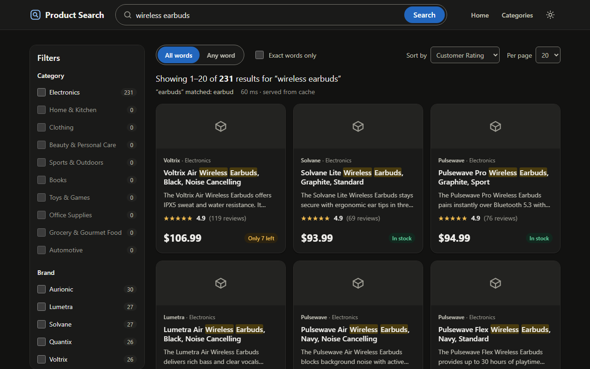
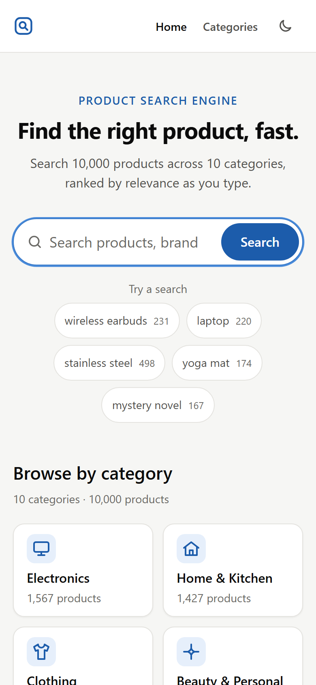
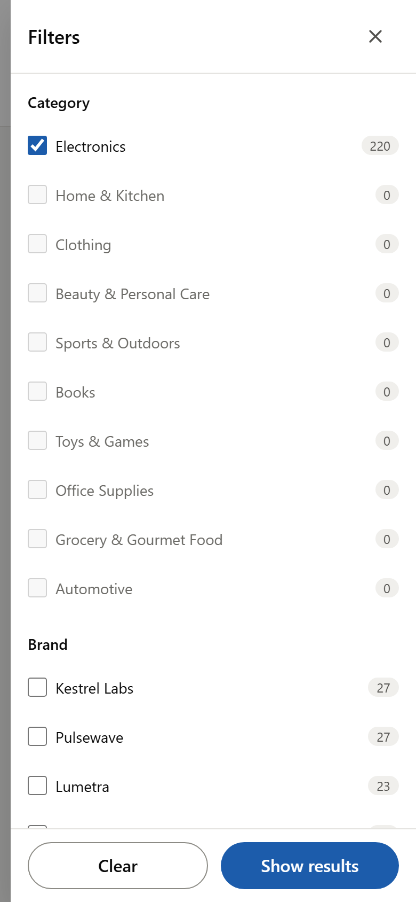
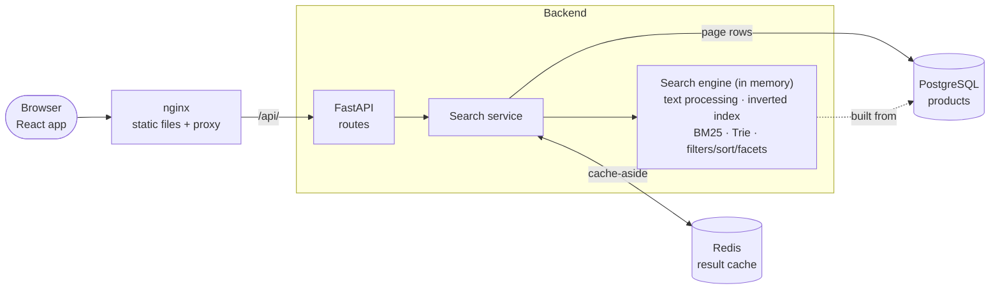
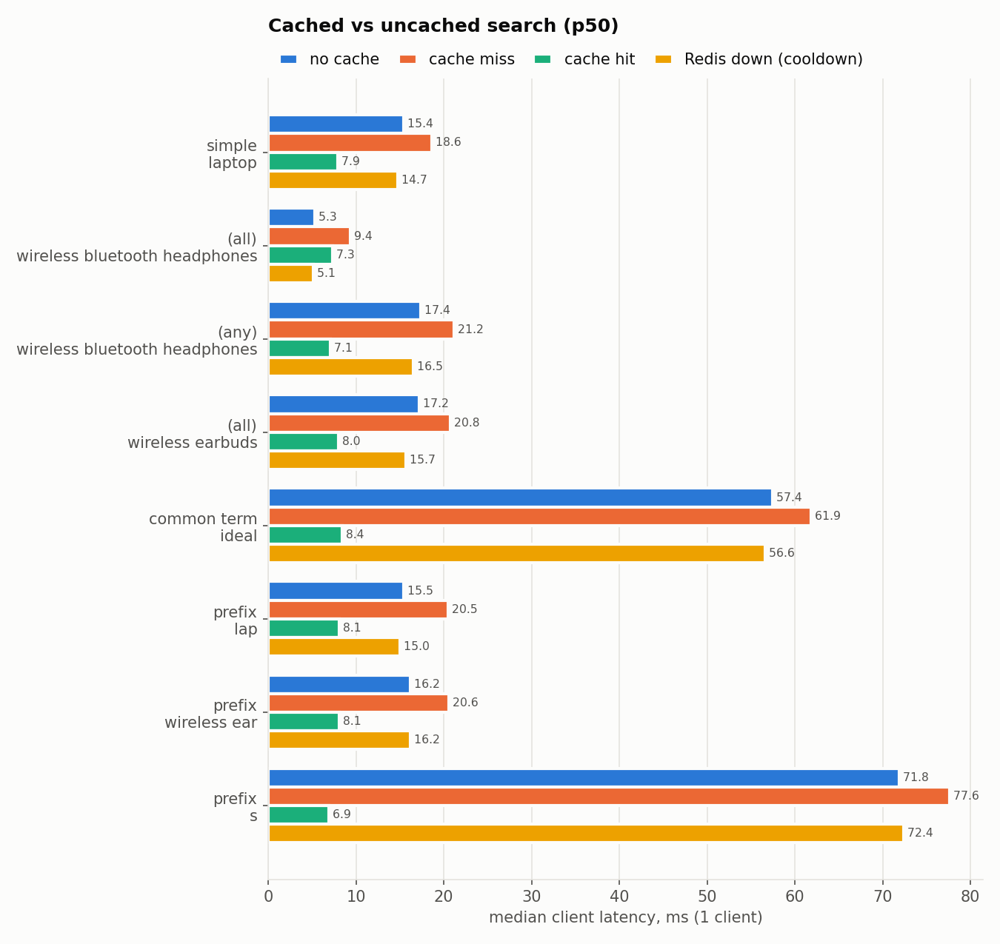

# Scalable Product Search Engine

A full-stack product search platform that implements its own search pipeline: an
**inverted index** with **BM25** relevance ranking, **Trie**-based autocomplete and prefix
search, **Redis** result caching, and server-side **filters, sorting, facets and pagination**,
served by **FastAPI** and a **React** frontend, and packaged with **Docker Compose**.


> A portfolio project built on a **synthetic catalogue of 10,000 products** with fictional
> brands. It is **not affiliated with Amazon** or any retailer, and uses no real product data
> or images.



## Contents

[Features](#features) · [Screenshots](#screenshots) · [Quickstart](#quickstart-docker) ·
[Architecture](#architecture) · [How search works](#how-search-works) ·
[Performance](#performance) · [Local development](#local-development) · [API](#api) ·
[Project structure](#project-structure) · [Testing](#testing) ·
[Limitations](#limitations-and-future-work) · [Documentation](#documentation)

## Features

**Search engine (implemented from scratch, no search library)**
- Full-text search across product **name, description, brand and category**
- **All words** (AND) or **any word** (OR) matching
- **BM25** relevance ranking with field weights (name 3, brand 2, category 2, description 1)
- **Prefix search**: the last word can be unfinished (`wireless ear` finds earbuds)
- **Autocomplete** from a **Trie** of the index vocabulary, ranked by how many products use each word
- Text normalisation: case, punctuation, hyphens (`wi-fi` = `wifi`), stop words, simple plurals

**Filtering and navigation (server-side)**
- Filters: category and brand (multi-select), price range, minimum rating, in stock
- Sorting: relevance, price (both directions), customer rating, newest
- **Facet counts** for categories and brands over all matches (each facet ignores its own filter)
- Pagination after ranking, filtering and sorting

**Performance**
- **Redis cache-aside** for search responses, with versioned keys tied to the index build,
  a 5-minute TTL, and graceful fallback when Redis is down (`X-Cache: HIT | MISS | BYPASS`)
- In-memory index with atomic rebuilds; only the requested page is read from PostgreSQL
- Reproducible **benchmarks** of components, HTTP latency, caching and concurrency

**Frontend (React 19 + Vite)**
- Home page with real catalogue statistics, category browsing and example searches
- Search page with autocomplete, filter sidebar (drawer on phones), active-filter chips, sort
  and pagination; all search state lives in the URL (refresh, Back/Forward and links work)
- Product detail page with breadcrumbs and "Back to results"; **"Similar products" is a
  search for the product's name within its category, not a trained recommendation model**
- Responsive layout, **light and dark themes** (system preference + saved toggle),
  keyboard and screen-reader accessibility

**Delivery**
- **Docker Compose**: PostgreSQL, Redis, an idempotent seed job, the API and nginx, one command
- Tests: 449 backend (pytest), 320 frontend (Vitest), 31 live end-to-end; GitHub Actions CI

## Screenshots

All screenshots are captured from the running application (Docker build, headless Microsoft
Edge). See [docs/testing.md](docs/testing.md#real-browser-verification-and-screenshots).

| Home page | Autocomplete |
|---|---|
|  |  |
| **Product details** | **Dark theme** |
|  |  |

| Mobile home | Mobile filter drawer |
|---|---|
|  |  |

## Quickstart (Docker)

The easiest way to run everything. You need **Git** and **Docker Desktop**, and Docker
Desktop must be **running**.

```powershell
git clone https://github.com/janejbraganza/Amazon-Product-Search-Engine.git
cd Amazon-Product-Search-Engine
docker compose --profile app up --build -d
```

Open **http://localhost:8080**. The first start builds the images and loads the catalogue
(a few minutes); later starts take seconds.

```powershell
docker compose --profile app ps                 # status and health
docker compose --profile app logs -f backend    # follow the API logs
docker compose --profile app up --build -d      # rebuild after code changes
docker compose --profile app down               # stop and remove containers (data is kept)
```

Product data lives in the Docker volume `pgdata` and survives restarts and rebuilds; only
`docker compose down -v` deletes it. No configuration is needed for local use; optional
settings are in [.env.example](.env.example). More in [docs/docker.md](docs/docker.md).

## Architecture



PostgreSQL is the source of truth. The search engine is one in-memory object (postings,
BM25 statistics, Trie, filter metadata) built from it at start-up and swapped atomically on
rebuild. Redis caches complete search responses; if it's unavailable, search still works.
Details: [docs/architecture.md](docs/architecture.md).

## How search works

The order used by `GET /api/v1/search`, verified against the code
(`backend/app/services/search_service.py`):

1. **Validate** the request (blank query or `min_price > max_price` → 422).
2. **Normalise** the query with the same pipeline as the product text (lowercase, split,
   stop words, plurals), and build the **cache key**.
3. **Redis lookup**: a hit returns the stored response immediately.
4. **Prefix expansion** (`prefix=true`): the unfinished last word becomes up to 50 complete
   words from the **Trie**.
5. **Match** in the **inverted index**: intersection (all words) or union (any word).
6. **Rank** every match with **BM25**; ties by product ID.
7. **Facets**: category and brand counts over all matches.
8. **Filter** by category, brand, price, rating and stock (index metadata, no SQL).
9. **Sort** by relevance, price, rating or date.
10. **Paginate**, then fetch only that page's products from **PostgreSQL** in one query.
11. **Store** the response in Redis for 5 minutes.

### BM25 in brief

Matching only tells you *whether* a product contains the words; `ideal` matches all 10,000
products. BM25 decides which come first, using:

- **Term frequency**, with diminishing returns (`k1 = 1.2`): more mentions help, but less and less.
- **Inverse document frequency** (Lucene's non-negative "+1" variant): rare words like
  `earbud` (231 products) count far more than common ones like `black` (1,739).
- **Length normalisation** (`b = 0.75`): a match in a short product text counts for more.
- **Field weights**: a word in the name counts 3×, in the brand or category 2×, in the
  description 1× (a simplified BM25F).

### Trie autocomplete in brief

A Trie stores words character by character, so all words starting with `ear` sit below the
node reached by walking `e → a → r`. Finding them costs time proportional to the prefix
length plus the matches, not the size of the vocabulary, so nothing is scanned per
keystroke. On this catalogue (1,733 words, 5,971 nodes) a completion takes **11–16 µs**.

### Redis caching in brief

Keys look like `pse:search:v2:{index_build_id}:{sha256 of normalised parameters}`. Because
every index build gets a new random `build_id`, a rebuild automatically makes old entries
unreachable: no deletes, so nothing can go wrong if Redis is down at that moment. Entries
expire after 300 s. Redis calls have a 0.25 s timeout and no retries, and after a failure
Redis is skipped for 30 s, so an outage costs one slow request instead of slowing every search.

Full explanations, formulas, a worked BM25 example with real numbers and the cache design:
[docs/search-engine.md](docs/search-engine.md).

## Performance

Measured on a laptop (Ryzen 5 5600H, 7.3 GB RAM, Windows 11) with a real Uvicorn server and
PostgreSQL/Redis in Docker Desktop, all on one machine; single runs, so treat them as relative
comparisons. Full methodology and tables: [docs/performance.md](docs/performance.md).

| Measurement (p50) | Result | Type |
|-------------------|--------|------|
| Typical uncached search (`laptop`, 220 matches) | 15.4 ms (server 13.3 ms) | HTTP |
| Matching + BM25 ranking for `laptop` | 0.64 ms | component |
| Broadest uncached search (`s` prefix, 9,769 matches) | 71.8 ms | HTTP |
| Cached search (any query) | 6.9–8.4 ms | HTTP, cache hit |
| Autocomplete request / Trie lookup | 3.7 ms / 11–16 µs | HTTP / component |
| Throughput with 20 clients | ~48 req/s uncached, ~263 req/s cached | concurrency |
| Index build, 10,000 products | 1.65 s, ≈24 MB | component |



What the numbers show, honestly:
- For typical queries the search algorithm takes under 1 ms; most of a request is the
  PostgreSQL page fetch. Very broad queries are dominated by BM25 scoring of every match.
- Caching speeds up expensive queries up to ~10× and typical ones ~2×, but a cache **miss**
  costs 3–6 ms extra, and an already-cheap query is slightly *slower* from the cache.
- Uncached throughput levels off at ~50 req/s: one Python worker, CPU-bound ranking.
- Adding facet counts to every search (Stage 5) made uncached unfiltered searches a few ms
  slower (`laptop` 15.4 → 18.4 ms in a later run); cache hits were unaffected.

## Local development

For working on the code. Requires **Python 3.13**, **Node.js 24 LTS** (or 22.22+),
and Docker Desktop (running) for PostgreSQL and Redis. Commands are for Windows PowerShell.

```powershell
# 1. Databases only (the app services are not started by this command)
docker compose up -d                  # PostgreSQL 127.0.0.1:5432, Redis 127.0.0.1:6379

# 2. Backend (terminal 1)
cd backend
python -m venv .venv
.\.venv\Scripts\Activate.ps1
pip install -r requirements-dev.txt   # runtime + test/lint tools
copy .env.example .env                # local development settings (no real secrets)
python -m scripts.seed                # create tables and load the 10,000 products (idempotent)
uvicorn app.main:app --reload         # http://127.0.0.1:8000/docs

# 3. Frontend (terminal 2)
cd frontend
npm ci
npm run dev                           # http://localhost:5173 (proxies /api to the backend)
```

On macOS/Linux, activate with `source .venv/bin/activate` and use `cp` instead of `copy`.
The dataset can also be generated as a CSV (`python -m scripts.generate_products`) and
loaded with `python -m scripts.load_products`; see [docs/architecture.md](docs/architecture.md#data).

## API

| Method | Endpoint | Description | Key parameters |
|--------|----------|-------------|----------------|
| GET | `/health` | Liveness check | – |
| GET | `/api/v1/products` | Catalogue listing by ID | `limit` (1–100), `offset` |
| GET | `/api/v1/products/{id}` | One product (404 if missing) | – |
| GET | `/api/v1/categories` | Categories with product counts | – |
| GET | `/api/v1/search` | Ranked search with filters, sort, facets; `X-Cache` header | `q`, `mode`, `prefix`, `sort`, `category`*, `brand`*, `min_price`, `max_price`, `min_rating`, `in_stock`, `limit`, `offset` |
| GET | `/api/v1/search/suggestions` | Autocomplete for the last word | `q`, `limit` (1–50) |
| POST | `/api/v1/search/rebuild-index` | Rebuild the in-memory index; **disabled (404) when `APP_ENV=production`**, as in Docker | – |

\* repeatable. Parameters, examples and errors: [docs/api.md](docs/api.md). Interactive
OpenAPI docs are at http://127.0.0.1:8000/docs in local development (not exposed by nginx).

## Project structure

```
backend/
  app/
    api/v1/         HTTP routes
    search/         text processing, inverted index, BM25, Trie, filters, index manager
    services/       search pipeline, cache-aside wrapper, product queries
    cache/          Redis client and search cache
    core/ database/ models/ schemas/
  scripts/          dataset generator, loader, seed job, index inspection
  tests/            pytest suite
frontend/
  src/              pages, components, hooks, API client, utilities, design tokens
docker/             Dockerfiles, their .dockerignore allow-lists, nginx config
benchmarks/         benchmark scripts; results/latest/ holds the published results and graphs
docs/               architecture, search engine, API, performance, Docker, testing, screenshots
.github/workflows/  CI
docker-compose.yml  databases by default; the full app with --profile app
```

## Testing

| Check | Command | Latest result |
|-------|---------|---------------|
| Backend tests (pytest, real PostgreSQL test database) | `cd backend; python -m pytest --cov=app` | 449 passed, 99% coverage of `app/` |
| Backend lint and format (Ruff) | `python -m ruff check .; python -m ruff format --check .` | clean |
| Frontend unit/component tests (Vitest, mocked API) | `cd frontend; npm run test:coverage` | 320 passed, ~99% statement coverage |
| Frontend lint and format | `npm run lint; npm run format:check` | clean |
| Production build | `npm run build` | succeeds |
| Live tests (real pages + real backend) | `npm run test:live` | 31 passed (via Vite and via Docker) |
| Real-browser checks (headless Edge) | – | 12/12 flows passed, no horizontal overflow at 320–1440 px |

Unit tests run in jsdom against a mocked API; live tests render the real pages against the
real backend; browser checks drive a real browser engine. CI (GitHub Actions) runs the
backend, frontend and Docker build checks on every push and pull request. Details:
[docs/testing.md](docs/testing.md).

## Limitations and future work

- **Synthetic data:** 10,000 generated products with a fixed vocabulary and no images.
- **Single-process, in-memory index:** one Uvicorn worker; more workers would each hold a copy.
  Throughput for uncached broad queries is CPU-bound.
- **Index freshness:** product changes made directly in PostgreSQL reach search, filters and
  facets only after an index rebuild or restart.
- **Similar products** are search-based (BM25 on the product name), not learned recommendations.
- **Local deployment only:** a public deployment would need HTTPS, secrets management, a Redis
  password and authentication (the rebuild endpoint is disabled in production for this reason).
- **Benchmarks** are single runs on one laptop.

## Documentation

| Document | Contents |
|----------|----------|
| [docs/architecture.md](docs/architecture.md) | System and component overview, frontend design, dataset, schema, design decisions |
| [docs/search-engine.md](docs/search-engine.md) | Search pipeline, text processing, inverted index, BM25, Trie, filters/facets, Redis cache |
| [docs/api.md](docs/api.md) | Every endpoint with parameters, examples and errors |
| [docs/performance.md](docs/performance.md) | Benchmark methodology, results, graphs and limitations |
| [docs/docker.md](docs/docker.md) | Compose services, images, nginx, persistence, security notes |
| [docs/testing.md](docs/testing.md) | Test suites, live tests, browser verification, CI |

## License

[MIT](LICENSE)
