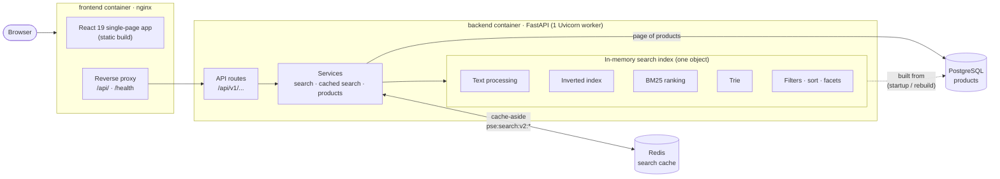

# Architecture

Contents: [System overview](#system-overview) · [Backend](#backend) ·
[Frontend](#frontend) · [Data](#data) · [Design decisions](#design-decisions)

## System overview



- **One origin.** The browser only talks to nginx, which serves the React build and forwards
  `/api/` and `/health` to FastAPI, so no CORS configuration is needed. In development, the
  Vite dev server plays the same role.
- **PostgreSQL is the source of truth** for products. The search index is derived from it.
- **The search index is in the API process's memory.** It holds the postings, BM25
  statistics, the Trie and the per-product metadata used for filtering and sorting, all in one
  `InvertedIndex` object that is replaced as a whole on rebuild.
- **Redis is an optional cache.** If it's unavailable, every search still works
  (`X-Cache: BYPASS`).

## Backend

```
backend/app/
  api/v1/        HTTP routes: products, categories, search, suggestions, rebuild-index
  core/          settings (pydantic-settings, read from environment / backend/.env)
  database/      SQLAlchemy engine, sessions, table creation
  models/        SQLAlchemy model: products
  schemas/       Pydantic request/response models
  search/        text_processing, inverted_index, bm25, trie, filters, index_manager
  services/      search_service (pipeline), cached_search (cache-aside), product_service
  cache/         redis_client (short timeouts, no retries), search_cache (keys, TTL, cooldown)
  main.py        FastAPI app, /health, optional index warm-up at start-up
backend/scripts/ generate_products, load_products, init_db, build_index, seed (Docker)
```

Request flow for a search: route (validation) → `cached_search` (cache key, Redis lookup) →
`search_service` (Trie expansion, matching, BM25, facets, filters, sort, pagination) →
PostgreSQL (only the 20 or so rows of the page) → response. The full order is documented in
[search-engine.md](search-engine.md#search-pipeline).

Routes are plain `def` functions, so FastAPI runs them in a thread pool and blocking database
or Redis calls never block the event loop.

## Frontend

React 19 + Vite, JavaScript (JSX), CSS Modules with design tokens, React Router. No UI or
state-management library.

```
frontend/src/
  api/          fetch wrapper (timeouts, cancellation, user-safe errors) + endpoint functions
  hooks/        useSearch, useSuggestions, useProduct, useCategories, useTheme, ...
  pages/        HomePage, SearchPage, ProductPage, NotFoundPage
  components/   layout (header, footer, theme toggle), search (form, cards, controls,
                pagination), filters (sidebar panel, mobile drawer, chips), product, states
  utils/        URL search state, formatting, highlighting, catalogue helpers, theme
  styles/       design tokens (light and dark) and global styles
```

- **The URL is the state.** Query, match mode, sort, filters, page and page size live in the
  URL (`/search?q=laptop&category=Electronics&sort=price_asc&page=2`), so refresh,
  Back/Forward and shared links always reproduce the same results.
- **No stale results.** Each request is keyed by its parameters and cancelled with an
  `AbortController` when superseded, so an older response can never overwrite a newer one.
- **The backend does all filtering, sorting and counting.** The frontend never filters or
  counts results itself; facet counts come only from the API response.
- **Autocomplete** follows the WAI-ARIA combobox pattern; requests are debounced and cancelled.
- **Product page:** "Back to results" returns to the exact search it came from. "Similar
  products" is a **search** for the product's name within its category (BM25), not a trained
  recommendation model.
- **Responsive and accessible:** filter sidebar on desktop, filter drawer (focus-trapped
  dialog) on phones; light and dark themes from design tokens, following the operating system
  with a saved manual override; one `h1` per page, labelled landmarks, live-region
  announcements, visible focus indicators, WCAG AA text contrast in both themes.

## Data

### Product catalogue

A synthetic catalogue of **10,000 products**, built by `backend/scripts/generate_products.py`
from curated word lists in `backend/scripts/catalog_data.py` (no Faker): every name and
description is assembled from real product vocabulary, so the text is meaningful to search.
**All brands are fictional, and the project is not affiliated with Amazon or any retailer.**

| Property        | Value |
|-----------------|-------|
| Products        | 10,000 (IDs 1–10000, every product name unique) |
| Categories      | 10: Electronics, Home & Kitchen, Clothing, Sports & Outdoors, Beauty & Personal Care, Books, Toys & Games, Office Supplies, Automotive, Grocery & Gourmet Food |
| Product types   | 57 (e.g. Laptop, Air Fryer, Running Shoes, Mystery Novel, Dash Cam) |
| Brands          | 82, all fictional |
| Price           | $3.95 – $2,365.95, a realistic range for each product type |
| Rating          | 1.0 – 5.0, mean ≈ 4.1 |
| Review count    | 1 – ~17,000, long-tailed |
| Stock           | 0 – 1,000; about 5% out of stock |
| created_at      | Spread over the 2 years before 2026-10-31 (fixed, not "now") |
| Reproducibility | Seed 42: the same seed always produces a byte-identical CSV |

Example: **Ember & Oak Artisan Chef Knife, 10-inch, Pakkawood Handle** · Home & Kitchen ·
$67.99 · 3.6★ (1,210 reviews).

```powershell
cd backend
python -m scripts.generate_products     # 10,000 products -> ../data/products.csv (seed 42, git-ignored)
python -m scripts.load_products         # validate with Pydantic, insert in batches of 1,000
python -m scripts.seed                  # what Docker runs: tables + catalogue if missing
```

Loading is idempotent: rows are inserted with `INSERT ... ON CONFLICT (id) DO NOTHING`, so a
second run inserts nothing. A bad value or duplicate ID stops the load with the line number.

### Database schema

Table `products` (`backend/app/models/product.py`):

| Column | PostgreSQL type | Constraints / index | Why |
|--------|-----------------|---------------------|-----|
| `id` | `BIGINT GENERATED BY DEFAULT AS IDENTITY` | primary key | Accepts the dataset's fixed IDs (safe re-loading) and still auto-numbers new rows |
| `product_name` | `VARCHAR(255)` | NOT NULL, not blank | |
| `description` | `TEXT` | NOT NULL, not blank | Main input for search |
| `category` | `VARCHAR(100)` | NOT NULL, B-tree index | |
| `brand` | `VARCHAR(100)` | NOT NULL, B-tree index | |
| `price` | `NUMERIC(10,2)` | NOT NULL, `> 0`, index | Exact decimal for money (never float) |
| `rating` | `NUMERIC(2,1)` | NOT NULL, `BETWEEN 1 AND 5`, index | |
| `review_count` | `INTEGER` | NOT NULL, default 0, `>= 0` | |
| `stock_quantity` | `INTEGER` | NOT NULL, default 0, `>= 0` | 0 = out of stock |
| `created_at` | `TIMESTAMPTZ` | NOT NULL, default `now()`, index | Time-zone aware |

CHECK constraints are named (`ck_products_*`), so errors say which rule failed. Tables are
created with `Base.metadata.create_all` (safe to re-run); Alembic migrations can replace this
once the schema starts changing.

## Design decisions

| Decision | Why | Trade-off |
|----------|-----|-----------|
| Own inverted index + BM25 instead of Elasticsearch or PostgreSQL full-text search | The point of the project is to implement and measure the search pipeline | Index lives in one process's memory; not distributed |
| Field-weighted BM25 (simplified BM25F: name 3, brand 2, category 2, description 1) | Product names describe a product better than long descriptions | Weights are fixed at build time |
| Trie for prefixes, separate from the inverted index | Prefix lookup cost depends on the prefix length, not the vocabulary size | Extra memory (≈1.3 MB here) |
| Filters, sort and facets on index metadata, after ranking | One consistent snapshot per request, no extra database queries | Metadata is stale until a rebuild |
| Only the page's rows come from PostgreSQL | PostgreSQL stays the source of truth for details; one small query per request | One database round trip per uncached search |
| Cache-aside with versioned keys (`build_id` in the key) | Invalidation without deletes; safe when Redis is down or a rebuild races a search | Old entries linger until their TTL expires |
| Short Redis timeouts, no retries, 30 s cooldown | A cache must never make search slower than no cache | Cache unavailable for up to 30 s after a blip |
| One Uvicorn worker | Each worker would build and hold its own index copy | CPU-bound throughput is limited by one process (see [performance.md](performance.md#3-concurrency)) |
| Search state in the URL | Refresh, Back/Forward and sharing work for free | Long URLs with many filters |
| nginx serves the SPA and proxies the API | One origin, no CORS, static assets cached for a year | One more container |
