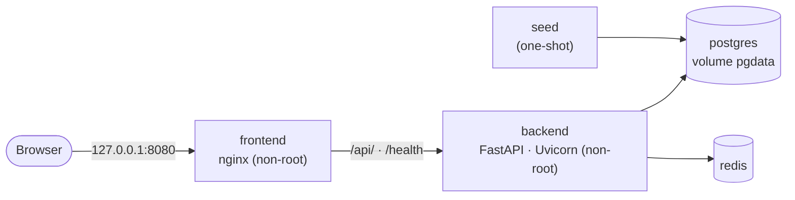

# Docker

Two ways to use Docker, both from the repository root. **Docker Desktop (or Docker Engine)
must be running**, with Docker Compose v2 (`docker compose`).

| Command | Starts | Use it for |
|---------|--------|-----------|
| `docker compose up -d` | PostgreSQL + Redis only | Local development (backend and Vite run on your machine) |
| `docker compose --profile app up --build -d` | The complete application at **http://localhost:8080** | Running or demoing the whole project |

## Complete application

```powershell
docker compose --profile app up --build -d
```

The first start builds both images and takes a few minutes. Then open http://localhost:8080.



| Service | Image / Dockerfile | What it does |
|---------|--------------------|--------------|
| `postgres` | `postgres:18-alpine` | Product data in the named volume `pgdata` |
| `redis` | `redis:8-alpine` | Search-result cache |
| `seed` | `docker/backend.Dockerfile` | One-shot job: creates tables and loads the 10,000-product catalogue if it's missing, then exits |
| `backend` | `docker/backend.Dockerfile` | FastAPI on Uvicorn (1 worker), builds the search index at start-up, `APP_ENV=production` |
| `frontend` | `docker/frontend.Dockerfile` | nginx serving the React build and proxying `/api/` and `/health` to the backend |

**Start-up order** (enforced with health checks): PostgreSQL and Redis healthy → seed job
finished successfully → backend healthy → frontend.

## Everyday commands

```powershell
docker compose --profile app ps                     # status and health
docker compose --profile app logs -f backend        # follow one service's logs
docker compose --profile app logs seed              # what the seed job did
docker compose --profile app up --build -d          # rebuild images after code changes
docker compose --profile app build --no-cache       # full rebuild, ignoring the build cache
docker compose --profile app stop                   # stop everything, keep containers
docker compose --profile app down                   # stop and remove containers (data kept)
```

## Images

| | Backend | Frontend |
|---|---|---|
| Base | `python:3.13-slim` | build: `node:24-alpine` · runtime: `nginxinc/nginx-unprivileged:1.29-alpine` |
| Contents | Runtime dependencies (`requirements.txt`), `app/`, `scripts/` | The static Vite build only (no Node, no `node_modules`) |
| User | `app` (uid 10001) | `nginx` (uid 101) |
| Health check | `GET /health` | `GET /nginx-health` |

Each Dockerfile has an allow-list `.dockerignore` (`docker/*.Dockerfile.dockerignore`), so
only the files it needs are sent to the build: `.env`, virtual environments,
`node_modules`, tests, caches, data and benchmark results never are.

## nginx

`docker/nginx.conf`:
- serves the React build with an SPA fallback (every route returns `index.html`; the app shows
  its own 404 page);
- forwards only `/api/` and `/health` to the backend (resolved through Docker's DNS on each
  request, so a restarted backend is found again). `/docs` and `/openapi.json` are **not**
  exposed;
- gzip for JS, CSS, JSON and SVG;
- hashed `/assets/` files cached for a year (`immutable`), `index.html` revalidated on every
  visit (`no-cache`), so new deployments reach users immediately;
- `X-Content-Type-Options`, `X-Frame-Options`, `Referrer-Policy`, and no version in `Server`.

## Configuration

The defaults work out of the box for local use. To change them, copy `.env.example` (repository
root) to `.env` and edit `POSTGRES_USER`, `POSTGRES_PASSWORD`, `POSTGRES_DB` or `APP_PORT`.
`.env` is git-ignored. The database credentials only apply when the data volume is first
created, and the password is used inside a database URL, so avoid `@ : / ? # %` in it.

## Persistence and seeding

PostgreSQL data lives in the named volume `pgdata`, shared by both ways of running. It
survives `stop`, `down`, restarts and image rebuilds. **Only `docker compose down -v` (or
`docker volume rm`) deletes it.**

The seed job is safe on every start: if all 10,000 products are present it does nothing;
otherwise it generates the catalogue (seed 42, byte-identical to `data/products.csv`) and
inserts only the missing products. Existing rows are never changed or duplicated. Redis has no
named volume: it only holds the search cache, whose entries expire after 5 minutes.

## Security notes

- Only the frontend is published, on `127.0.0.1:8080`. The backend has no published port;
  PostgreSQL and Redis are bound to `127.0.0.1`.
- Containers run as non-root users.
- `APP_ENV=production` disables `POST /api/v1/search/rebuild-index` (no authentication yet).
- This setup is meant for **local use**. A public deployment would also need HTTPS, real
  secrets management, a Redis password and authentication for admin endpoints.

## Verified behaviour (Stage 8)

- `docker compose up -d` starts only PostgreSQL and Redis; host development is unchanged.
- The full stack serves search, autocomplete, filters, sorting, pagination, product pages and
  categories at http://localhost:8080; the frontend's 31 live tests pass against it.
- A clean start in an isolated Compose project (new volume) seeded 10,000 products whose
  contents matched the development database exactly; a second start inserted nothing.
- Data survived container restarts and `down`/`up`; containers stop cleanly in ~3 s.
