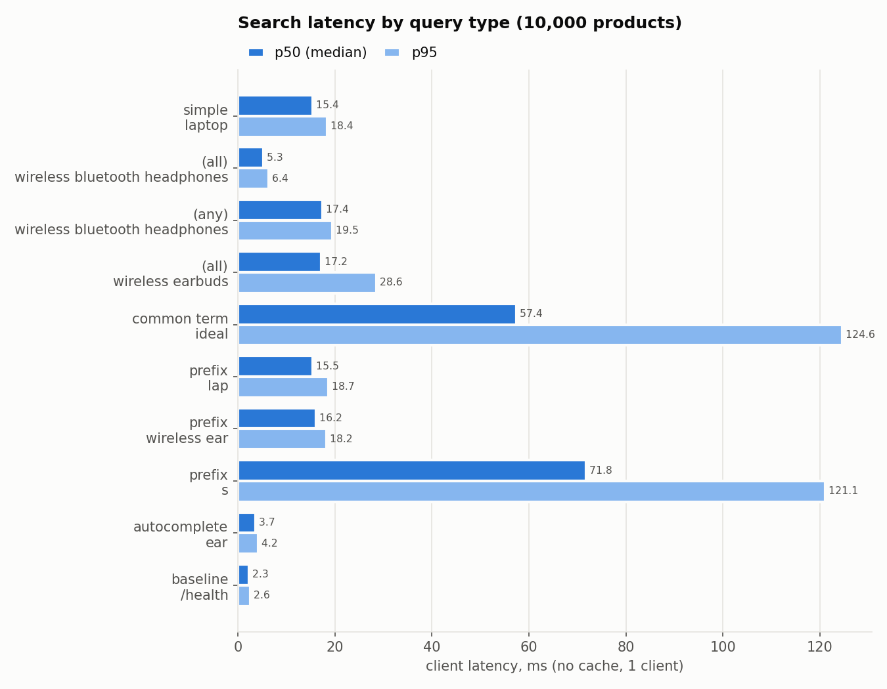
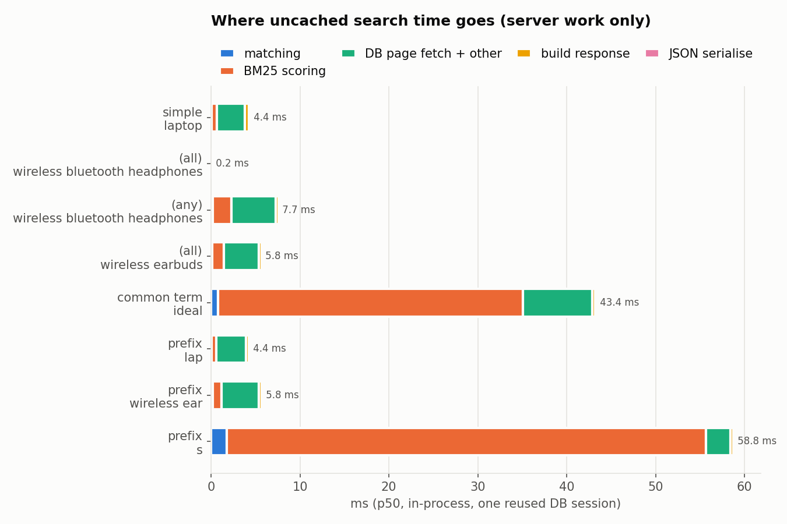
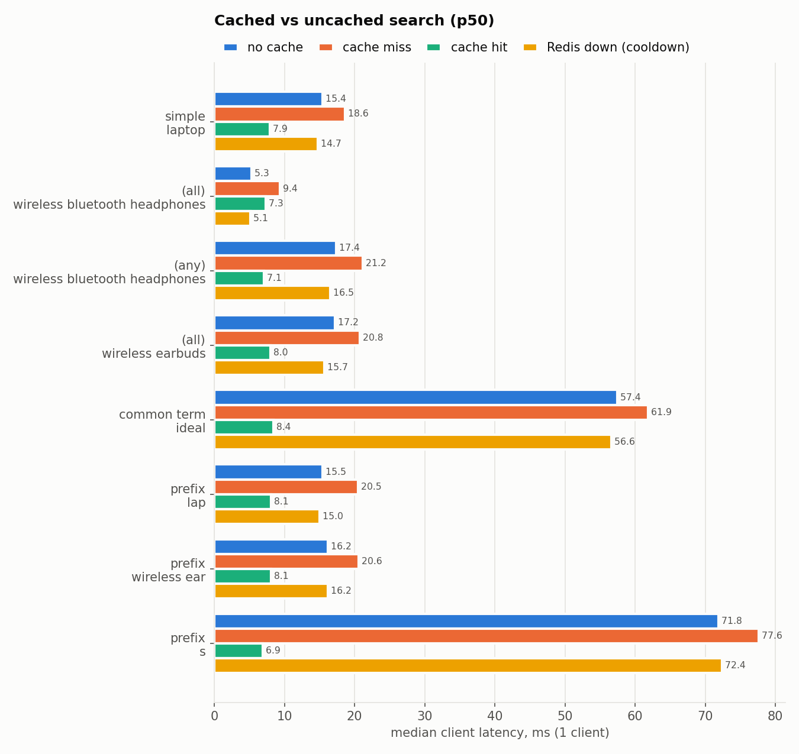
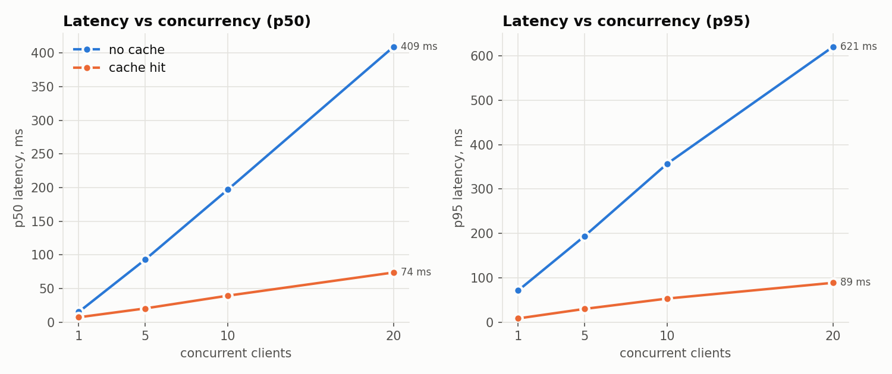
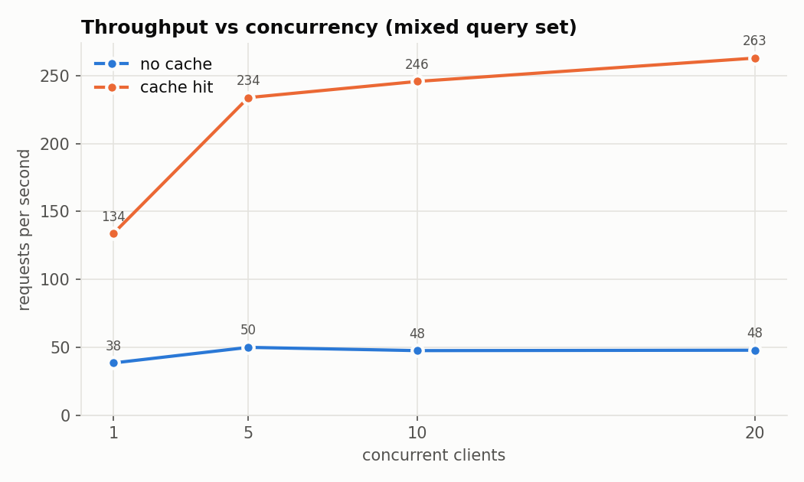
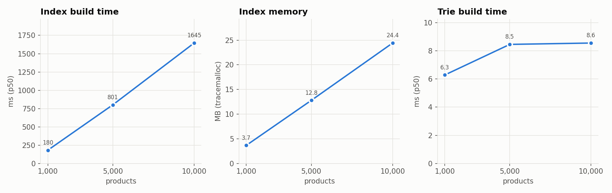

# Performance benchmarks

All numbers on this page come from the result files in
[`benchmarks/results/latest/`](../benchmarks/results/latest/) (`summary.md`,
`components.json`, `http.json`, `filters.json`, `environment.json`). They were measured on a
student laptop, so read them as **relative comparisons** between parts of this system, not as
production latencies.

Contents: [Environment](#environment) · [Methodology](#methodology) ·
[Results at a glance](#results-at-a-glance) · [1. Latency by query](#1-latency-by-query-no-cache-1-client) ·
[2. Cached vs uncached](#2-cached-vs-uncached) · [3. Concurrency](#3-concurrency) ·
[4. Scaling, memory, build time](#4-catalogue-scaling-memory-and-build-time) ·
[5. Filters, sorting and facets](#5-filters-sorting-and-facets-stage-5) ·
[Limitations](#limitations) · [Reproducing](#reproducing)

## Environment

| | |
|---|---|
| Machine | Laptop, AMD Ryzen 5 5600H (6 cores / 12 threads), 7.3 GB RAM, Windows 11 |
| Software | Python 3.13.15, FastAPI 0.162.5, uvicorn 0.54.0, SQLAlchemy 2.1.8, psycopg 3.3.9, redis-py 8.1.0 |
| Services | PostgreSQL 18.7 and Redis 8.10.3 in Docker Desktop. Client, server and both services all on **the same machine** |
| Data | 10,000 synthetic products (1,000 / 5,000 / 10,000 for the scaling test) |
| Runs | Main suite (sections 1–4): one full run on 2026-11-13. Filter suite (section 5): a separate run after filters, sorting and facets were added |

## Methodology

Benchmark code lives in `benchmarks/`, separate from the application; no application code,
schema or API behaviour was changed to run it. Three layers are measured separately, so each
number means one thing:

| Layer | What it isolates | How |
|-------|------------------|-----|
| **A. Components** (`bench_components.py`) | Pure algorithm time: index and Trie build, matching vs BM25 scoring, prefix completion, index memory, catalogue scaling | In-process calls to the app's functions, `time.perf_counter`; memory from `tracemalloc` |
| **B. HTTP latency** (`bench_http.py`) | End-to-end request time: no cache, cache miss, cache hit, Redis unavailable; autocomplete; `/health` baseline | A **real uvicorn server** (1 worker) in its own process, one `httpx` client over a reused connection |
| **C. Concurrency** (`bench_http.py`) | Latency and throughput with 1, 5, 10 and 20 concurrent clients, uncached and cache-hit | One thread and connection per client; 400 requests per level, round-robin mix of all queries |

- **Client vs server time.** A benchmark-only launcher (`bench_server.py`) wraps the app from
  the outside and adds a `Server-Timing` header, so each request has a **client time** (what
  a caller waits) and a **server time** (the API's own work). The launcher also adds a control
  route that switches the cache off / on / down; that route doesn't exist in the real app.
- **Repeatable conditions.** Fixed queries, seed-42 data, 20 unmeasured warm-up requests,
  then 200 measured requests per scenario (Redis-down: 50).
- **Misses and hits never mixed.** Before each miss sample the cache switches to a brand-new
  key prefix (verified `X-Cache: MISS`); hit samples repeat a filled entry (verified `HIT`).
- **Every response is checked** against the expected product IDs and total.
- **Safety.** The benchmark only reads the real database; Redis use is limited to database 15
  and a per-run key prefix, deleted at the end (never `FLUSHDB`/`FLUSHALL`).

Fixed query set:

| Name | Request |
|------|---------|
| simple | `q=laptop` (220 results) |
| multi-term (all) | `q=wireless bluetooth headphones` (**0 results**: no product contains "headphones") |
| multi-term (any) | same with `mode=any` (686 results) |
| multi-term (all) | `q=wireless earbuds` (231 results) |
| common term | `q=ideal` (all 10,000 products match) |
| prefix | `q=lap`, `q=wireless ear`, `q=s` with `prefix=true` (`s`: 50 completions, 9,769 products) |
| autocomplete | `GET /api/v1/search/suggestions?q=ear` |

## Results at a glance

| Measurement | Result | Layer |
|-------------|--------|-------|
| Typical uncached search (`laptop`) | 15.4 ms p50 client, 13.3 ms server | HTTP |
| Matching + BM25 for `laptop` | 0.64 ms p50 | component |
| Broadest uncached search (`s`, prefix, 9,769 matches) | 71.8 ms p50 | HTTP |
| Cache hit, any query | 6.9–8.4 ms p50 | HTTP |
| Autocomplete request (`ear`) | 3.7 ms p50 (`/health` floor: 2.3 ms) | HTTP |
| Trie completion (`ear`, `lap`) | 11–16 µs | component |
| Throughput, 20 clients | ~48 req/s uncached, ~263 req/s cache hits | concurrency |
| Correctness under concurrency | 3,200 / 3,200 requests correct, 0 errors | concurrency |
| Full index build (10,000 products) | 1.65 s p50; index ≈ 24.4 MB (`tracemalloc`) | component |

## 1. Latency by query (no cache, 1 client)



| Query | Results | Client p50 | p95 | p99 | Server p50 | req/s |
|-------|---------|-----------|-----|-----|-----------|-------|
| `laptop` | 220 | 15.4 ms | 18.4 | 32.3 | 13.3 ms | 62 |
| `wireless bluetooth headphones` (all) | 0 | 5.3 ms | 6.4 | 7.3 | 3.5 ms | 187 |
| `wireless bluetooth headphones` (any) | 686 | 17.4 ms | 19.5 | 20.1 | 15.5 ms | 58 |
| `wireless earbuds` | 231 | 17.2 ms | 28.6 | 36.5 | 15.1 ms | 53 |
| `ideal` (all products) | 10,000 | 57.4 ms | 124.6 | 161.1 | 55.4 ms | 16 |
| `lap` (prefix) | 220 | 15.5 ms | 18.7 | 20.5 | 13.4 ms | 63 |
| `wireless ear` (prefix) | 231 | 16.2 ms | 18.3 | 19.7 | 14.1 ms | 62 |
| `s` (prefix) | 9,769 | 71.8 ms | 121.1 | 146.3 | 69.7 ms | 13 |
| autocomplete `ear` | 3 words | 3.7 ms | 4.2 | 4.9 | | 271 |
| `/health` (baseline) | | 2.3 ms | 2.6 | 2.9 | | 436 |

**Where the time goes in an uncached search** (in-process, p50):



| Query | Matching | BM25 scoring | `search_products` total (ranking + page fetch) | Build response | JSON |
|-------|----------|--------------|-----------------------------------------------|----------------|------|
| `laptop` | 0.04 ms | 0.60 ms | 4.10 ms | 0.47 ms | 0.14 ms |
| `wireless earbuds` | 0.15 ms | 1.32 ms | 4.90 ms | 0.31 ms | 0.08 ms |
| `ideal` | 0.76 ms | 34.3 ms | 43.6 ms | 0.36 ms | 0.14 ms |
| `s` (prefix) | 1.79 ms | 53.9 ms | 64.4 ms | 0.30 ms | 0.11 ms |

| PostgreSQL step (p50) | Time |
|-----------------------|------|
| Fetch a 20-product page, reused session | 3.10 ms |
| Fetch a 20-product page, **new session** (what each API request does) | **8.17 ms** |
| Open and close a session (pool checkout, pre-ping) | 1.54 ms |

What this means:
- **For typical queries the search algorithm is a small part of the request.** For `laptop`,
  matching and BM25 together take about 0.6 ms of a 13 ms server time; about 8 ms is the
  PostgreSQL session and page fetch (each Docker Desktop round trip costs about 1.5 ms here).
- **Very broad queries are dominated by BM25 scoring,** because every match must be scored
  before the top 20 can be chosen: `ideal` scores 10,000 products (34 ms), `s` 9,769 (54 ms).
  Matching itself stays under 2 ms.
- **A query with no matches is the cheapest:** `mode=all` stops as soon as the intersection is
  empty and needs no database fetch (3.5 ms server time).
- **Prefix search costs about the same as the full word** (`lap` 15.5 ms vs `laptop` 15.4 ms).
  The Trie lookup itself takes 11–16 µs (0.43 ms for `s`, which has 203 completions before the
  limit is applied).
- **Autocomplete never touches PostgreSQL** (3.7 ms end to end against a 2.3 ms floor).

## 2. Cached vs uncached



| Query (client p50) | No cache | Cache miss | Cache hit | Redis down (cooldown) | Hit vs no cache |
|--------------------|----------|-----------|-----------|-----------------------|-----------------|
| `laptop` | 15.4 ms | 18.6 ms | 7.9 ms | 14.7 ms | 1.9× faster |
| `wireless bluetooth headphones` (all, 0 results) | 5.3 ms | 9.4 ms | 7.3 ms | 5.1 ms | **1.4× slower** |
| `wireless bluetooth headphones` (any) | 17.4 ms | 21.2 ms | 7.1 ms | 16.5 ms | 2.4× faster |
| `wireless earbuds` | 17.2 ms | 20.8 ms | 8.0 ms | 15.7 ms | 2.1× faster |
| `ideal` | 57.4 ms | 61.9 ms | 8.4 ms | 56.6 ms | 6.8× faster |
| `lap` (prefix) | 15.5 ms | 20.5 ms | 8.1 ms | 15.0 ms | 1.9× faster |
| `wireless ear` (prefix) | 16.2 ms | 20.6 ms | 8.1 ms | 16.2 ms | 2.0× faster |
| `s` (prefix) | 71.8 ms | 77.6 ms | 6.9 ms | 72.4 ms | 10.4× faster |

Redis unavailable, **first** request (waits for the 0.25 s connection timeout): 259–425 ms
depending on the query. During the 30 s cooldown after that, requests take about the same as
with no cache.

What this means (including the trade-offs):
- **A cache hit costs about 7–8 ms whatever the query** (server time 5–6 ms: a Redis `GET` of
  about 1.6 ms plus validating and returning the stored JSON). Caching helps expensive queries
  most (`s` 10×, `ideal` 7×) and typical ones about 2×.
- **Caching can be slower:** a query that's already cheap (the 0-result search, 5.3 ms) is
  slower from the cache (7.3 ms).
- **A miss costs 3–6 ms more than no cache:** one Redis `GET` that finds nothing plus one `SET`.
  That's the price of caching a request that is never repeated.
- **A Redis outage costs one slow request,** not one per request (short timeout + cooldown).

## 3. Concurrency




| Cache | Clients | req/s | p50 | p95 | p99 | Errors | Incorrect |
|-------|---------|-------|-----|-----|-----|--------|-----------|
| no cache | 1 | 38.4 | 15.1 ms | 71.1 ms | 116.8 ms | 0 | 0 |
| no cache | 5 | 49.9 | 92.8 ms | 193.7 ms | 224.2 ms | 0 | 0 |
| no cache | 10 | 47.5 | 197.0 ms | 357.2 ms | 399.2 ms | 0 | 0 |
| no cache | 20 | 47.8 | 409.2 ms | 620.8 ms | 667.9 ms | 0 | 0 |
| cache hit | 1 | 133.6 | 7.2 ms | 8.3 ms | 8.8 ms | 0 | 0 |
| cache hit | 5 | 233.8 | 20.3 ms | 29.7 ms | 38.3 ms | 0 | 0 |
| cache hit | 10 | 245.7 | 39.3 ms | 53.1 ms | 60.7 ms | 0 | 0 |
| cache hit | 20 | 262.9 | 73.7 ms | 88.6 ms | 121.3 ms | 0 | 0 |

**All 3,200 concurrent requests returned correct results, with no errors.**

What this means:
- **Uncached throughput levels off at about 48–50 req/s from 5 clients.** With more clients,
  requests wait longer: p50 roughly doubles each time the client count doubles.
- **The reason is the server design:** one Python process. Ranking is CPU work, and the GIL
  lets one thread run Python code at a time, so extra threads only overlap database and
  Redis waits.
- **Cache hits reach about 5× the throughput** (~250–263 req/s) because each needs far less
  CPU; they level off beyond 10 clients for the same reason.
- **The mix includes two very broad queries** (`ideal`, `s`: 25% of requests), which is why
  the uncached 1-client p95 (71 ms) is far above its p50 (15 ms).
- **What would scale it further** (not implemented): more uvicorn worker processes (each with
  its own index), and limiting how many results are scored for very broad queries.

## 4. Catalogue scaling, memory and build time



| Products | Distinct terms | Postings | Trie nodes | Index build (p50) | Trie build (p50) | Index memory |
|----------|---------------|----------|-----------|-------------------|------------------|--------------|
| 1,000 | 1,721 | 36,725 | 5,939 | 180 ms | 6.3 ms | 3.7 MB |
| 5,000 | 1,733 | 183,332 | 5,971 | 801 ms | 8.5 ms | 12.8 MB |
| 10,000 | 1,733 | 366,584 | 5,971 | 1,645 ms | 8.6 ms | 24.4 MB |

| Ranking time (p50) | 1,000 | 5,000 | 10,000 |
|--------------------|-------|-------|--------|
| `laptop` | 0.08 ms | 0.28 ms | 0.64 ms |
| `wireless earbuds` | 0.08 ms | 0.44 ms | 1.47 ms |
| `ideal` | 3.1 ms | 15.8 ms | 35.0 ms |
| `s` (prefix) | 4.1 ms | 25.5 ms | 55.7 ms |

| API server process memory (`psutil` RSS) | Memory |
|------------------------------------------|--------|
| Server started | 88.6 MB |
| After the first search builds the index | 123.5 MB |
| End of the benchmark | 136.4 MB |

The first search (which built the index) took 2.3 s, including reading 10,000 rows (~164 ms).

What this means:
- **Index build time and memory grow linearly:** about 165 ms and 2.4 MB per 1,000 products.
- **Ranking time grows with the number of matching products;** scoring very broad queries is
  what would need attention for a much larger catalogue.
- **The Trie doesn't grow because the synthetic vocabulary doesn't:** 5,000 products already
  contain all 1,733 words. A real catalogue would keep adding words.
- **RSS grew by 35 MB when the index was built,** more than the 24.4 MB `tracemalloc` reports,
  because RSS also includes allocator overhead and rows read during the build.

## 5. Filters, sorting and facets (Stage 5)

Filters, sorting and facet counts were added after the main run. `bench_filters.py` measured
them with the same HTTP method (real uvicorn server, 1 client), 100 measured requests after 10
warm-up per scenario, results in `filters.json`.

| Scenario (client p50) | Results | No cache | Cache miss | Cache hit |
|-----------------------|---------|----------|------------|-----------|
| `laptop` unfiltered | 220 | 18.4 ms | 24.4 ms | 9.6 ms |
| `laptop` + category | 220 | 18.9 ms | 23.9 ms | 9.7 ms |
| `laptop` + brand | 23 | 18.9 ms | 23.7 ms | 9.3 ms |
| `laptop` + combined filters | 44 | 19.5 ms | 23.8 ms | 9.6 ms |
| `laptop` sorted by price | 220 | 18.9 ms | 23.7 ms | 9.6 ms |
| `ideal` unfiltered | 10,000 | 69.3 ms | 75.3 ms | 9.8 ms |
| `ideal` + category | 1,567 | 78.1 ms | 80.8 ms | 9.2 ms |
| `ideal` + combined filters | 879 | 79.0 ms | 83.3 ms | 9.6 ms |
| `ideal` sorted by price (asc) | 10,000 | 81.4 ms | 86.9 ms | 9.6 ms |
| `ideal` sorted by newest | 10,000 | 87.5 ms | 93.8 ms | 9.6 ms |

| In-process step (p50) | `laptop` (220 matches) | `ideal` (10,000 matches) |
|-----------------------|------------------------|--------------------------|
| BM25 ranking | 0.65 ms | 38.5 ms |
| Facet counts, no filters | 0.25 ms | 16.9 ms |
| Facet counts, combined filters | 0.24 ms | 21.6 ms |
| Applying combined filters | 0.20 ms | 7.9 ms |
| Sorting all matches by price | 0.25 ms | 31.1 ms |

The honest trade-off: **facet counts are now computed on every search**, so an *unfiltered*
uncached search became slower than in the main run (`laptop` p50 15.4 → 18.4 ms, `ideal`
57.4 → 69.3 ms, measured in separate runs on the same machine). For typical queries the
filter, facet and sort steps add well under 1 ms of work each; for a query matching the
whole catalogue they add tens of milliseconds. Cache hits are unaffected (≈ 9–10 ms). The
concurrency results in section 3 were measured before this change, so current uncached
throughput is likely somewhat lower than shown there.

## Limitations

- **One laptop, single runs.** Numbers vary between runs and machines; p99 from 100–200
  samples is only a rough estimate.
- **Everything shares one machine** (client, server, PostgreSQL, Redis), and Docker Desktop's
  virtual network adds about 1.5 ms per database or Redis round trip.
- **Single uvicorn worker.** The concurrency results describe this setup only.
- **Synthetic data** with a small, fixed vocabulary, which affects Trie and term statistics.
- **Two values are derived, not measured directly:** BM25 scoring time is "ranking minus
  matching" from two medians, and the in-process breakdown uses one reused database session
  (the per-request session cost is measured separately).
- **Memory:** `tracemalloc` counts only Python allocations and RSS includes the whole process;
  neither is an exact index size.
- The Docker image (Stage 8) was not benchmarked; these numbers come from the host setup.

## Reproducing

```powershell
docker compose up -d                                   # PostgreSQL + Redis, catalogue loaded
cd backend
.\.venv\Scripts\python.exe -m pip install -r ..\benchmarks\requirements.txt   # matplotlib, psutil
.\.venv\Scripts\python.exe ..\benchmarks\run_all.py --quick    # smoke test, about 2 minutes
.\.venv\Scripts\python.exe ..\benchmarks\run_all.py            # full run, about 10-15 minutes
.\.venv\Scripts\python.exe ..\benchmarks\bench_filters.py      # filter/sort/facet suite
```

`run_all.py` **overwrites** `benchmarks/results/latest/` (the published results). Copy that
folder first if you want to keep them.

### Earlier in-process cache benchmark (Phase 6)

Before the HTTP suite existed, `benchmarks/search_cache_benchmark.py` measured the cache
through FastAPI's in-process `TestClient` (about 11 ms of client overhead per request).
Its headline results, superseded by section 2: a cache hit cost about 16–18 ms through the
test client whatever the query, against 24–99 ms uncached; a seeded mixed workload of 2,000
requests over 8 queries had a 99.6% hit rate (only because the workload repeats 8 queries)
and a mean of 17.65 ms with the cache vs 33.69 ms without.
