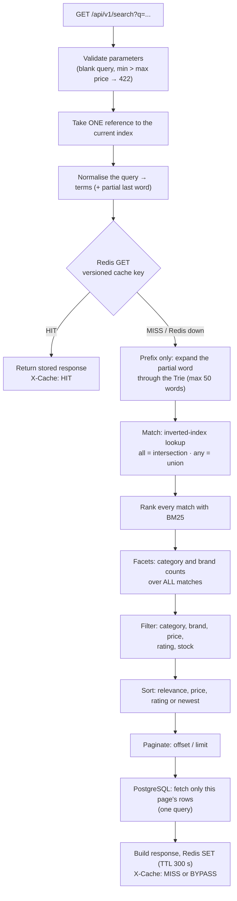

# Search engine

How a query becomes a ranked, filtered page of products. Everything here is implemented in
`backend/app/search/` (algorithms), `backend/app/services/` (use cases) and
`backend/app/cache/` (Redis). No search library is used: the inverted index, BM25, the Trie,
filtering, facets and the cache are this project's own code.

Contents:
[Search pipeline](#search-pipeline) ·
[Text processing](#text-processing) ·
[Inverted index](#inverted-index) ·
[BM25 ranking](#bm25-ranking) ·
[Trie, autocomplete and prefix search](#trie-autocomplete-and-prefix-search) ·
[Filters, sorting and facets](#filters-sorting-and-facets) ·
[Search-result cache (Redis)](#search-result-cache-redis) ·
[Index lifecycle](#index-lifecycle)

Measured timings for every step are in [performance.md](performance.md).

---

## Search pipeline

The exact order used by `GET /api/v1/search` (`app/api/v1/search.py` →
`app/services/cached_search.py` → `app/services/search_service.py`):



| Step | What happens | Code |
|------|--------------|------|
| 1 | Validate. A blank query, a query with no searchable words, or `min_price > max_price` → 422. Never cached | `api/v1/search.py`, `search/filters.py` |
| 2 | Take **one** reference to the live index. It's used for the cache key, matching, ranking, facets, filters and sorting, so one request always sees one consistent snapshot | `api/v1/search.py` |
| 3 | Normalise the query with the same pipeline as product text | `search/text_processing.py` |
| 4 | Look up the cache. A hit returns immediately | `services/cached_search.py` |
| 5 | `prefix=true` only: complete the last word through the Trie | `search/inverted_index.py`, `search/trie.py` |
| 6 | Match candidates in the inverted index (`mode=all`: intersection; `mode=any`: union) | `search/inverted_index.py` |
| 7 | Score **every** candidate with BM25, highest first, ties by product ID | `search/bm25.py`, `search/inverted_index.py` |
| 8 | Count facets over all matches (each facet ignores its own filter) | `search/filters.py` |
| 9 | Apply filters using product metadata stored **in the index** (no database query) | `search/filters.py` |
| 10 | Sort. For non-relevance sorts only the first `offset + limit` results are fully ordered (heap) | `search/filters.py` |
| 11 | Cut out the requested page | `services/search_service.py` |
| 12 | Fetch only the page's product rows from PostgreSQL in one query, keeping the ranked order | `services/search_service.py` |
| 13 | Store the response in Redis (if the page is complete and Redis is reachable) | `services/cached_search.py`, `cache/search_cache.py` |

The route functions are plain `def` (not `async def`), so FastAPI runs them in its thread
pool; blocking PostgreSQL and Redis calls never block the event loop.

---

## Text processing

The same steps run on product text and on queries, so they always agree
(`app/search/text_processing.py`):

| Step | Example |
|------|---------|
| Unicode normalisation (NFKC) and lowercasing | `CAFÉ` → `café` |
| Drop possessives and apostrophes | `Men's` → `men`, `Kids'` → `kids` |
| Split on punctuation, keeping decimals | `Black/White, 15.6-inch` → `black`, `white`, `15.6`, `inch` |
| Hyphenated words: keep the parts **and** the joined form | `Wi-Fi` → `wi`, `fi`, `wifi` (so `wifi`, `wi-fi` and `wi fi` all match) |
| Remove 45 stop words | `the`, `and`, `with`, `for`… (`free`, `c`, `up`, `no` are deliberately **kept**) |
| Fold simple plurals | `laptops` → `laptop`, `batteries` → `battery`, `watches` → `watch` (`glass`, `series`, `lens` unchanged) |

A partial word typed for autocomplete is lowercased and normalised, but **stop words are
kept** (`for` may become `fork`) and **plurals are not folded** (`ba` isn't a plural). If the
prefix looks like a finished plural (`laptops`), its singular (`laptop`) is also completed,
because index terms are stored in singular form.

---

## Inverted index

A book's index lists each important word with the pages it appears on, so you go straight to
those pages instead of reading the whole book. An **inverted index** does the same for
products: it maps each **word** to the **IDs of the products** that contain it.

```
Products                                   Inverted index (word -> product IDs)
1  "Voltrix Pro Laptop"                    laptop   -> {1, 3}
2  "Hearthwell Air Fryer"         ==>      voltrix  -> {1, 3}
3  "Voltrix Air Laptop"                    air      -> {2, 3}
                                           fryer    -> {2}
```

To answer `voltrix air`, the engine looks up both words and keeps the IDs they have in common:
`{1, 3} ∩ {2, 3} = {3}`. It never reads any product's text at query time.

**How this project builds it:**

| Step | Code | What happens |
|------|------|--------------|
| 1 | `search/index_manager.py` | Streams `id`, the four text fields and the filter/sort columns (price, rating, stock, created_at) from PostgreSQL in chunks of 1,000, in one query |
| 2 | `search/text_processing.py` | Turns `product_name`, `brand`, `category` and `description` into terms |
| 3 | `search/inverted_index.py` | Records each product **once** per term, with its field-weighted term frequency, plus the product's length (the statistics BM25 needs) and its filter/sort metadata |
| 4 | `search/trie.py` | Builds the Trie from the index's vocabulary (term → product count) |

On the full catalogue: **1,733 distinct terms**, **366,584 postings** (term → product pairs),
average product length 66.09 field-weighted terms, **5,971 Trie nodes**.

**Matching:**
- `mode=all` (default): products containing **every** query word, by set intersection,
  starting with the smallest set.
- `mode=any`: products containing **at least one** query word (set union).
- Unknown words have no postings: in `all` mode they produce no results, in `any` mode they
  add nothing. Either way they're reported in `unmatched_terms`.
- Repeated query words count once (`laptop laptop` = `laptop`).

---

## BM25 ranking

### Why simple keyword matching isn't enough

Matching only tells you *whether* a product contains the words. A search for `laptop`
matches 220 products, and `ideal` matches all 10,000. Ranking decides which come first. Just
counting matches would favour long descriptions that repeat words, and treat a rare,
specific word (`earbud`) the same as a word in almost every product (`ideal`).

### BM25 in simple terms

BM25 ("Best Matching 25") is the standard ranking function used by Lucene, Elasticsearch and
OpenSearch. It scores each matching product with three ideas:

1. **Term frequency.** A product that mentions the search word more often is probably more
   about it, but the benefit **levels off**: the 10th mention adds far less than the 2nd.
2. **Inverse document frequency (IDF).** Rare words matter more than common ones. Matching
   `earbud` (in 231 products) means much more than matching `black` (in 1,739). A word in
   every product, such as `ideal`, adds almost nothing.
3. **Length normalisation.** A word in a short product text counts for more than the same
   word in a long one, because it's a bigger part of what the product is about.

With several search words, the product's score is the sum of each word's contribution.

### The formula (as implemented in `app/search/bm25.py`)

```
score(d, q) = Σ  IDF(t) · tf(t,d) · (k1 + 1) / ( tf(t,d) + k1 · (1 − b + b · |d| / avgdl) )
             t∈q

IDF(t) = ln( 1 + (N − df(t) + 0.5) / (df(t) + 0.5) )
```

| Symbol | Meaning | Where it comes from in the index |
|--------|---------|----------------------------------|
| `tf(t,d)` | How often term *t* occurs in product *d* (field-weighted) | `postings[t][d]` |
| `df(t)` | Number of products containing *t* | `len(postings[t])` |
| `N` | Number of indexed products | `len(doc_lengths)` |
| `\|d\|` | Length of product *d* in terms (field-weighted) | `doc_lengths[d]` |
| `avgdl` | Average product length | `total_length / N` |
| `k1 = 1.2` | How quickly repeated words stop adding score | `BM25Config.k1` |
| `b = 0.75` | How strongly long products are penalised (0 = not at all, 1 = fully) | `BM25Config.b` |

`k1 = 1.2` and `b = 0.75` are the standard defaults. The IDF is the **"+1" variant used by
Lucene**. The original version becomes negative for words in more than half of all products,
which would make matching `ideal` *lower* a product's score; this version never goes below 0.

### Field weighting

A word in the product name says more than the same word in a long description. Each
occurrence is counted with its field's weight, and the product's length is weighted the same
way (a simplified form of **BM25F**):

```
tf(t,d) = 3 × (count in name) + 2 × (count in brand) + 2 × (count in category) + 1 × (count in description)
|d|     = 3 × (name length)   + 2 × (brand length)   + 2 × (category length)   + 1 × (description length)
```

| Field | Weight | Why |
|-------|--------|-----|
| `product_name` | 3 | Says what the product *is* |
| `brand` | 2 | Precise intent ("voltrix") |
| `category` | 2 | Broad intent ("electronics") |
| `description` | 1 | Long text with many incidental words |

The standard BM25 formula is then applied unchanged to one combined set of statistics.
Scoring each field separately and adding the results would need separate statistics per field
and would reward a word just for appearing in several fields. The weights live in
`BM25Config.field_weights`; they're applied at build time, so changing them needs a rebuild.

### Worked example (real data)

Query `wireless earbuds` → terms `wireless` (df 380) and `earbud` (df 231); N = 10,000 and
avgdl = 66.09.

| | #442 Voltrix Flex Wireless Earbuds | #9779 Kestrel Labs Flex Wireless Earbuds |
|---|---|---|
| tf(`wireless`), tf(`earbud`) | 4, 4 (3 from the name + 1 from the description) | 4, 4 |
| Product length `\|d\|` | 57.0 (shorter description) | 74.0 |
| IDF(`wireless`) = ln(1 + (10000 − 380 + 0.5)/(380 + 0.5)) | 3.2690 | 3.2690 |
| IDF(`earbud`) | 3.7659 | 3.7659 |
| Contribution of `wireless` + `earbud` | 5.6670 + 6.5284 | 5.4198 + 6.2437 |
| **Score** | **12.1954** (ranked near the top) | **11.6635** (ranked last of the 231) |

Both products match the words equally often; #442 wins because its text is shorter, so the
words make up a bigger share of it.

### How ranking fits into search

| Requirement | How it's handled |
|-------------|------------------|
| Most relevant first | Every match is scored and sorted by score, descending |
| Deterministic ties | Sort key `(−round(score, 6), product_id)`: equal scores come back in ascending ID order; rounding stops last-digit floating-point noise from deciding the order |
| Pagination after ranking | All matches are ranked first, so page 2 continues page 1 exactly |
| Speed | The length part `k1 · (1 − b + b · \|d\|/avgdl)` is computed once per product at build time, and each word's IDF once per query |
| Rebuild | Postings and all statistics are rebuilt together in a new index object, swapped in one step |

---

## Trie, autocomplete and prefix search

### What a Trie is

A **Trie** (prefix tree) stores words one character per node. The path from the root to a
node spells a prefix, and nodes that finish a word are marked (`*`). Words with a common start
share nodes:

```
(root)
  └─ l
      └─ a
          ├─ p *                 "lap"
          │   └─ t
          │       └─ o
          │           └─ p *     "laptop"
          └─ m
              └─ p *             "lamp"
```

To find every word starting with `la`: walk `l → a` (two steps), then collect the marked
nodes below. The walk takes as many steps as the prefix has characters, **however many words
the Trie holds**. Scanning the whole vocabulary would instead compare the prefix with every
word on every keystroke.

Code: `app/search/trie.py`. Each node has `children` (a dict holding only the characters
used), `is_word` and `frequency`; `__slots__` keeps nodes small. Words are collected with an
explicit stack (no recursion limit).

| Operation | Time | Notes |
|---|---|---|
| `insert(word)` | O(length of word) | Repeated inserts only add to the frequency |
| `contains` / `has_prefix` | O(p) | p = prefix length |
| `words_with_prefix(prefix, limit)` | O(p + n + k log m) | Walk the prefix, visit the n nodes below it, pick the top m = `limit` of the k words with a heap |
| Space | O(L) nodes worst case | L = total characters; shared prefixes stored once |

**Trie vs inverted index.** They answer different questions and work together:

| | Inverted index | Trie |
|---|---|---|
| Answers | "Which **products** contain `laptop`?" | "Which **words** start with `lap`?" |
| Used for | Matching and BM25 ranking | Autocomplete, and expanding a partial word |

### Autocomplete: `GET /api/v1/search/suggestions`

The **last word** of `q` is completed from the index vocabulary. Suggestions are ordered by
**number of products, then A–Z**, and each has a `display` form (how the word is most often
written in product text, e.g. `earbuds` for the stored term `earbud`).

```http
GET /api/v1/search/suggestions?q=wireless%20ear&limit=5
```

```json
{ "query": "wireless ear", "prefix": "ear",
  "suggestions": [ { "term": "earbud", "product_count": 231, "display": "earbuds" },
                   { "term": "early",  "product_count": 145, "display": "early" },
                   { "term": "ear",    "product_count": 96,  "display": "ear" } ] }
```

The frontend requests suggestions as you type (debounced, earlier requests cancelled) and
implements the WAI-ARIA combobox pattern (arrow keys, Enter, Escape).

### Prefix search: `GET /api/v1/search?q=...&prefix=true`

With `prefix=true` the **last word** is treated as unfinished and expanded through the Trie;
other words are complete. The web app sends `prefix=true` by default ("Exact words only"
turns it off); the API default is `false`.

```
"wireless ear"   ->  complete: ["wireless"]   partial: "ear"  ->  Trie: ["earbud", "early", "ear"]
"wireless ear "  ->  trailing space = the last word is finished, nothing is expanded
```

Each query word becomes a **group** of terms; a partial word becomes the group of its
completions: `groups = [["wireless"], ["earbud", "early", "ear"]]`.

| Step | Rule |
|------|------|
| Matching | A product matches a group if it contains **any** term in the group; `mode=all` needs every group, `mode=any` at least one |
| Scoring | Each group adds its **best** BM25 term score for the product, so one unfinished word counts once |
| Expansion cap | At most **50** completions, the most common first (the same default as Elasticsearch's `max_expansions`) |
| Unknown prefix | No completions: reported as `"xyz*"` in `unmatched_terms` |

When every group has one term, "best" is just that term's score, so normal searches score
exactly as plain BM25. This was checked bit-for-bit against the earlier ranking code and
against a brute-force scoring of all 10,000 products.

---

## Filters, sorting and facets

All three run **after** BM25 ranking, on product metadata stored in the same index object
(`app/search/filters.py`), so no extra database query is needed.

| Filter | Parameter | Rule |
|--------|-----------|------|
| Category | `category` (repeatable, max 20) | Case-insensitive; several values are OR-ed |
| Brand | `brand` (repeatable, max 20) | Case-insensitive; several values are OR-ed |
| Price | `min_price`, `max_price` | Inclusive, 2 decimals; `min_price > max_price` → 422 |
| Rating | `min_rating` | Inclusive, 0–5, 1 decimal |
| Stock | `in_stock=true` | Only `stock_quantity > 0` (`false` = no stock filter) |

Different filters are AND-ed. `total` in the response is the number of results **after**
filtering.

**Sorting** (`sort`): `relevance` (default, BM25), `price_asc`, `price_desc`, `rating`
(highest first) and `newest`. Ties always fall back to ascending product ID, so pages never
overlap or skip. For non-relevance sorts only the first `offset + limit` results are found
with a heap (`heapq.nsmallest`) instead of sorting every match.

**Facets** (`facets.categories`, `facets.brands`): `{value, count}` pairs counted over **all**
matching products, not just the current page. They are **disjunctive**: category counts apply
every active filter except the category filter (and brand counts every filter except the
brand filter), so choosing one category still shows how many results each other category
would give. Sorted by count, then name.

---

## Search-result cache (Redis)

Only `GET /api/v1/search` is cached, using **cache-aside**: look up first; on a miss, compute
and store. The cache sits in front of the search engine and doesn't change it.

### Cache key

```
pse:search:v2:{index_build_id}:{sha256 of canonical JSON of the normalised parameters}
```

| Part | Purpose |
|------|---------|
| `pse:search:` | The project's own namespace; nothing outside it is ever read or written |
| `v2` | Bumped when the response format or search behaviour changes (`v2` added filters and sort) |
| `index_build_id` | Random ID created for every index build: the invalidation mechanism (below) |
| SHA-256 | Everything that changes the response: normalised terms (in order), the partial word, `mode`, `prefix`, `limit`, `offset`, the expansion cap, filters (order-independent, case-folded, exact decimals) and `sort` |

Because the query is **normalised first**, `Laptop` and `LAPTOPS!` share one entry. `query`
is the only response field echoing the raw input, so it's filled in from the current request
on a hit.

### TTL, HIT and MISS

Entries expire after **300 seconds** (`SEARCH_CACHE_TTL_SECONDS`). The `X-Cache` response
header reports what happened:

| Value | Meaning |
|-------|---------|
| `HIT` | Served from Redis; the search engine didn't run |
| `MISS` | Computed, then stored in Redis |
| `BYPASS` | Computed and **not** stored: cache disabled, Redis unavailable, or the page was incomplete |

The TTL is also the longest that cached product details (price, stock) can lag behind the
database if rows change without an index rebuild.

### Why the cache is versioned (invalidation without deletes)

Every index build gets a new random `build_id`, and every key contains the `build_id` of
**the index object that produced the result**. After a rebuild, new requests use new keys, so
entries from the old index can **never be read again**; Redis deletes them when their TTL
expires. Invalidation needs no Redis command at all, so it can't fail if Redis is down during
a rebuild.

A search racing a rebuild is safe too: the request takes one index reference and uses it for
both the key and the ranking, so a result computed on the old index can only be stored under
the old ID, which no new request reads.

Alternatives considered: deleting `pse:search:*` on rebuild (slow, fails if Redis is down,
and a search finishing just after the delete can store a stale result again), or a shared
Redis counter (needs careful ordering, fails if Redis is down).

### When Redis is unavailable

| Situation | Behaviour |
|-----------|-----------|
| Redis down during lookup or store | The search runs normally and returns the correct result (`X-Cache: BYPASS`) |
| Corrupt or unreadable entry | Validated against the response schema on read; treated as a miss and replaced |
| Incomplete page (a product deleted since the last rebuild) | Returned, but not cached |
| Timeouts | 0.25 s connect/read timeout, no automatic retries (an unreachable Redis took about 6.4 s to fail with redis-py's default retries on the development machine) |
| Cooldown | After a failure Redis isn't contacted for 30 s, so an outage costs one short timeout, not one per request |
| Logging | One warning per failure, with credentials in URLs redacted (`redis://***@host`) |
| API users | Always see a normal search response, never a Redis error or stack trace |

| Setting (`backend/.env`) | Default | Meaning |
|--------------------------|---------|---------|
| `REDIS_URL` | `redis://127.0.0.1:6379/0` | Redis server and database |
| `SEARCH_CACHE_ENABLED` | `true` | Turn search caching off completely |
| `SEARCH_CACHE_TTL_SECONDS` | `300` | Entry lifetime |
| `REDIS_TIMEOUT_SECONDS` | `0.25` | Connect and read timeout per Redis call |
| `REDIS_RETRY_COOLDOWN_SECONDS` | `30` | After a failure, skip Redis for this long |

Inspecting the cache (development Redis):

```powershell
docker exec pse-redis redis-cli --scan --pattern "pse:search:*"
docker exec pse-redis redis-cli TTL "<key>"
```

---

## Index lifecycle

- The index (postings, BM25 statistics, filter/sort metadata and the Trie) lives **in the API
  process's memory**, in one `InvertedIndex` object.
- **Local development:** built on the first search (lazy), then reused.
- **Docker:** built while the server starts (`SEARCH_INDEX_WARMUP=true`), so the first search
  is as fast as the rest. A failed warm-up is logged and the lazy build is used instead.
- **Rebuild:** `POST /api/v1/search/rebuild-index` builds a complete new index and swaps it in
  with one reference assignment; searches running meanwhile keep using the old one. A lock
  prevents two simultaneous builds. The endpoint is disabled when `APP_ENV=production`.
- **Consequence:** product changes made directly in PostgreSQL aren't visible to search,
  filters or facets until the index is rebuilt (or the server restarts). Product *details* on
  a results page are always read fresh from PostgreSQL (or the cache, for at most 5 minutes).
